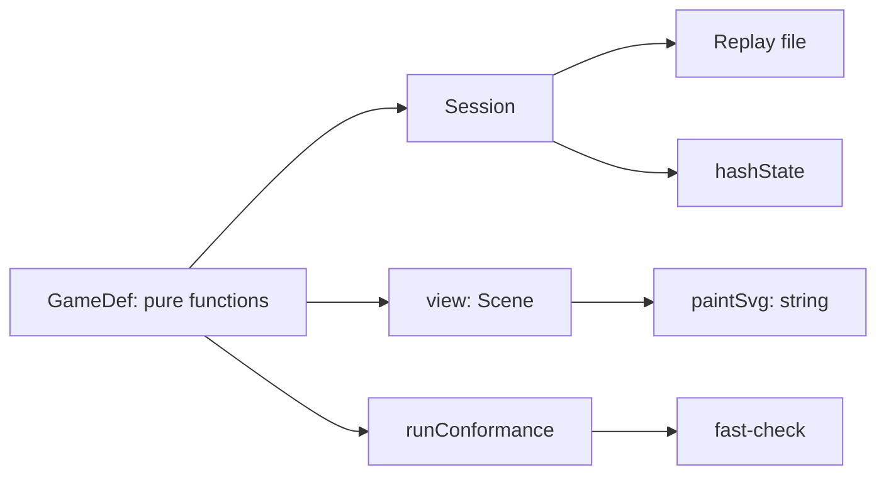

# Design Document

## Overview

`kit/core` is a small TypeScript package with no dependencies. It defines the game contract, runs sessions, makes and checks replays, hashes states, gives repeatable random numbers, and paints a scene as SVG text. `kit/conformance` depends on `kit/core` and fast-check. It holds the nine property tests and two sample games.

## Architecture



Files:

```
kit/core/src/types.ts        contract and scene types
kit/core/src/errors.ts       KitError and error codes
kit/core/src/canonical.ts    canonical JSON text
kit/core/src/hash.ts         hashState
kit/core/src/random.ts       nextRandom, randomInt
kit/core/src/rle.ts          expandActions, compressActions
kit/core/src/session.ts      createSession
kit/core/src/replay.ts       runReplay
kit/core/src/scene.ts        validateScene, paintSvg
kit/core/src/validate.ts     validateDef
kit/core/src/index.ts        the only export file
kit/conformance/src/index.ts runConformance
kit/conformance/sample-lights/  kit/conformance/sample-hop/  kit/conformance/broken/
```

## Components and Interfaces

```ts
export type Json = null | boolean | number | string | Json[] | { [key: string]: Json };
export type Phase = 'playing' | 'won' | 'lost';
export interface LevelRef { id: string; title: string }
export interface Status { phase: Phase; score: number; reason?: string }

export interface Observation {
  summary: string;                    // one plain line, at most 120 characters
  textMap?: string[];                 // rows of equal length, one character for each cell
  legend?: Record<string, string>;    // meaning of each character in textMap
  facts: Record<string, Json>;        // named values a tool can rely on
}

export interface Viewport {
  width: number; height: number;
  safe: { top: number; right: number; bottom: number; left: number };
}

export type Layer = 'back' | 'world' | 'actors' | 'fx' | 'hud';
export type SceneItem =
  | { kind: 'rect'; id: string; layer: Layer; x: number; y: number; w: number; h: number; fill: string; radius?: number; opacity?: number }
  | { kind: 'circle'; id: string; layer: Layer; cx: number; cy: number; r: number; fill: string; opacity?: number }
  | { kind: 'sprite'; id: string; layer: Layer; x: number; y: number; w: number; h: number; sprite: string; flipX?: boolean; opacity?: number }
  | { kind: 'text'; id: string; layer: Layer; x: number; y: number; text: string; size: number; fill: string; align: 'left' | 'center' | 'right' };
export interface Scene { width: number; height: number; items: SceneItem[] }

export interface GameDef<S extends Json, A> {
  id: string;
  title: string;
  rulesVersion: string;
  kind: 'turn' | 'tick';
  ticksPerSecond?: number;
  levels(): LevelRef[];
  init(levelId: string, seed: number): S;
  actions(state: S): A[];
  step(state: S, action: A): S;
  status(state: S): Status;
  observe(state: S): Observation;
  view(state: S, viewport: Viewport): Scene;
  encodeAction(action: A): string;
  decodeAction(text: string): A | null;
}

export interface Replay {
  format: 1; game: string; rulesVersion: string; level: string; seed: number;
  actions: string[]; finalHash: string; finalPhase: Phase;
}

export type ApplyResult =
  | { ok: true; hash: string; status: Status }
  | { ok: false; error: 'bad_action_text' | 'illegal_action' | 'game_over'; message: string };

export interface Session<S extends Json, A> {
  readonly def: GameDef<S, A>;
  readonly level: string;
  readonly seed: number;
  readonly state: S;
  readonly tick: number;
  legal(): string[];
  apply(actionText: string): ApplyResult;
  undo(): boolean;
  status(): Status;
  hash(): string;
  toReplay(): Replay;
}

export type ReplayResult =
  | { ok: true; finalHash: string; finalPhase: Phase }
  | { ok: false; error: 'wrong_game' | 'rules_changed' | 'bad_action_text' | 'illegal_action' | 'hash_mismatch' | 'phase_mismatch'; mismatchAt?: number; message: string };

export function createSession<S extends Json, A>(def: GameDef<S, A>, levelId: string, seed: number): Session<S, A>;
export function runReplay<S extends Json, A>(def: GameDef<S, A>, replay: Replay): ReplayResult;
export function hashState(state: Json): string;
export function nextRandom(rngState: number): { value: number; state: number };
export function randomInt(rngState: number, n: number): { value: number; state: number };
export function expandActions(items: string[]): { ok: true; actions: string[] } | { ok: false; message: string };
export function compressActions(actions: string[]): string[];
export function validateDef(def: GameDef<Json, unknown>): string[];
export function validateScene(scene: Scene): string[];
export function paintSvg(scene: Scene, options?: { sprites?: Record<string, string> }): string;

export class KitError extends Error {
  code: 'unknown_level' | 'bad_seed' | 'not_plain_data' | 'bad_def';
  path?: string;
}
```

Conformance:

```ts
export interface ConformanceOptions { runs?: number; maxActions?: number; seed?: number }
export interface PropertyResult { name: string; passed: boolean; counterexample?: Replay; message?: string }
export function runConformance<S extends Json, A>(def: GameDef<S, A>, options?: ConformanceOptions): PropertyResult[];
```

## Data Models

- Canonical JSON: object keys sorted by code unit order, no spaces, numbers written with `String(n)`, strings with `JSON.stringify`. Arrays keep their order.
- Hash: FNV-1a 64 bit over the UTF-8 bytes of the canonical JSON, computed with `BigInt`, written as 16 lower case hex characters with leading zeros.
- Random: the mulberry32 algorithm. `rngState` is an unsigned 32 bit integer. `randomInt` uses `value % n`. The small bias is accepted for n up to 65536.
- Session history: a stack of earlier states, turn games only, capped at 500 entries. When the cap is reached the oldest entry is dropped.
- Run length: `compressActions(['a','a','a','b'])` gives `['a*3','b']`. `expandActions` rejects a count below 2 or above 3600, a missing count, and a text with more than one `*`.

## Error Handling

- Bad input that comes from a tool or a file returns a typed result. It never throws.
- A programming mistake in a game definition throws `KitError` at session creation or at hash time, with the path of the bad value.
- A failed `apply` leaves the session exactly as it was. Tests compare the hash before and after.

## Testing Strategy

- Unit tests with Vitest sit next to each source file as `*.test.ts`. Each one is written first and seen to fail.
- Hash tests: `hashState({})` and `hashState({a:1,b:2})` equal `hashState` of the same objects built in the other key order. A second, slow reference hash written inside the test file with plain number arrays must agree on 200 random values.
- Random tests: the first 5 outputs for state 1 are compared with a reference loop written inside the test file from the published mulberry32 steps.
- Session tests use `sample-lights`. Level `l1` has only the centre lamp and its four neighbours on. `press:1,1` wins it in one action.
- Replay tests: a valid replay passes. The same replay with one action changed returns `illegal_action` or `hash_mismatch`. A replay with `rulesVersion` changed returns `rules_changed`.
- SVG tests: the output parses as XML with a tiny parser in the test, holds one element for each scene item, and escapes the text `a<b & "c"`.
- Conformance tests: both samples pass. Each of the three broken samples fails the named property.

## Correctness Properties

1. **Repeatable.** For any level, seed and legal action list, two fresh sessions give equal hashes after every action. (Requirements 2.3, 3.2)
2. **Replay round trip.** For any finished or unfinished run, `runReplay(def, session.toReplay())` is ok and returns the same hash and phase. (4.1, 4.3)
3. **Legal closure.** Every text from `legal()` is accepted by `apply`. A text outside `legal()` is refused and the hash does not change. (2.3, 2.4, 2.5)
4. **Plain data.** After every action, `JSON.parse(JSON.stringify(state))` is deep equal to the state and `hashState` does not throw. (3.3)
5. **Input not changed.** `def.step(state, action)` leaves its `state` argument with the same hash as before the call. (2.3)
6. **Game over is final.** When the phase is `won` or `lost`, `legal()` is empty and every `apply` returns `game_over`. (2.6)
7. **Action text round trip.** For every legal action, `decodeAction(encodeAction(a))` encodes to the same text, and no text contains `*`. (4.2)
8. **Undo.** On a turn game, `apply` then `undo` gives the hash from before the `apply`. (2.8)
9. **View and observation are safe.** After every action, `view` returns a scene with no problem from `validateScene`, and `observe` returns a summary of at most 120 characters and a text map whose rows have equal length. (6.1, 6.5)

## Decisions and Alternatives

- Pure functions over a class with hidden state. Chosen because a prover and a property test need to copy and compare states freely.
- FNV-1a over SHA-256. Chosen because it is synchronous and has no dependency. It is a fingerprint for tests, not a security feature.
- SVG text in the core, canvas in the shell. Chosen so that the tool door needs no browser and no native image library.
- fast-check (MIT licence, version pinned at scaffold time) for property tests.

## Out of Scope

- Rendering to canvas, input handling, sound and storage. They belong to the shell spec.
- Search and proofs. They belong to the tool door and prover spec.
- Network play, save files that survive a rules change, and floating point physics.
