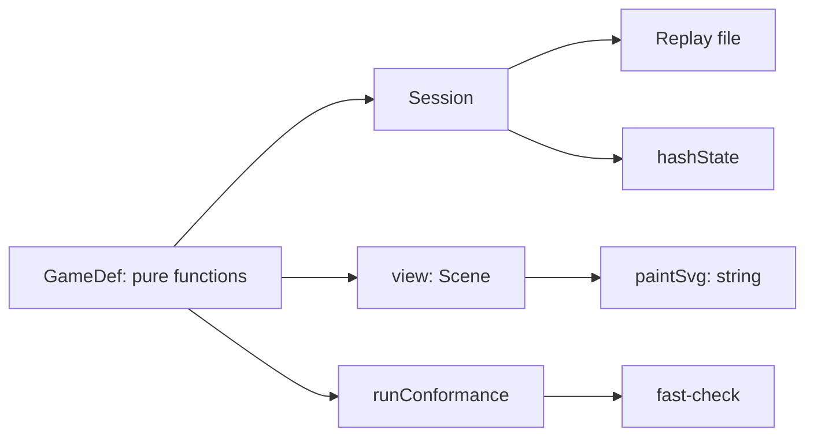

# Design Document

## Overview

`kit/core` is a small TypeScript package with no dependencies. It defines the game contract, runs sessions, makes and checks replays, hashes states, gives repeatable random numbers, and paints a scene as SVG text. `kit/conformance` depends on `kit/core` and fast-check. It holds the nine property tests and two sample games.

## Architecture



Files:

```
kit/core/src/types.ts        contract and scene types
kit/core/src/errors.ts       KitError and error codes
kit/core/src/canonical.ts    canonical JSON text
kit/core/src/hash.ts         hashState
kit/core/src/random.ts       nextRandom, randomInt
kit/core/src/rle.ts          expandActions, compressActions
kit/core/src/session.ts      createSession
kit/core/src/replay.ts       runReplay
kit/core/src/scene.ts        validateScene, paintSvg
kit/core/src/validate.ts     validateDef
kit/core/src/index.ts        the only export file
kit/conformance/src/index.ts runConformance and the two sample games (`sampleLights`, `sampleHop`)
kit/conformance/sample-lights/  kit/conformance/sample-hop/  kit/conformance/broken/
```

## Components and Interfaces

```ts
export type Json = null | boolean | number | string | Json[] | { [key: string]: Json };
export type Phase = 'playing' | 'won' | 'lost';
export interface LevelRef { id: string; title: string }
export interface Status { phase: Phase; score: number; reason?: string }

export interface Observation {
  summary: string;                    // one plain line, at most 120 characters
  textMap?: string[];                 // rows of equal length, one character for each cell
  legend?: Record<string, string>;    // meaning of each character in textMap
  facts: Record<string, Json>;        // named values a tool can rely on
}

export interface Viewport {
  width: number; height: number;
  safe: { top: number; right: number; bottom: number; left: number };
}

export type Layer = 'back' | 'world' | 'actors' | 'fx' | 'hud';
export type SceneItem =
  | { kind: 'rect'; id: string; layer: Layer; x: number; y: number; w: number; h: number; fill: string; radius?: number; opacity?: number }
  | { kind: 'circle'; id: string; layer: Layer; cx: number; cy: number; r: number; fill: string; opacity?: number }
  | { kind: 'sprite'; id: string; layer: Layer; x: number; y: number; w: number; h: number; sprite: string; flipX?: boolean; opacity?: number }
  | { kind: 'text'; id: string; layer: Layer; x: number; y: number; text: string; size: number; fill: string; align: 'left' | 'center' | 'right' };
export interface Scene { width: number; height: number; items: SceneItem[] }

export interface GameDef<S extends Json, A> {
  id: string;
  title: string;
  rulesVersion: string;
  kind: 'turn' | 'tick';
  ticksPerSecond?: number;
  levels(): LevelRef[];
  init(levelId: string, seed: number): S;
  actions(state: S): A[];
  step(state: S, action: A): S;
  status(state: S): Status;
  observe(state: S): Observation;
  view(state: S, viewport: Viewport): Scene;
  encodeAction(action: A): string;
  decodeAction(text: string): A | null;
}

export interface Replay {
  format: 1; game: string; rulesVersion: string; level: string; seed: number;
  actions: string[]; finalHash: string; finalPhase: Phase;
}

export type ApplyResult =
  | { ok: true; hash: string; status: Status }
  | { ok: false; error: 'bad_action_text' | 'illegal_action' | 'game_over'; message: string };

export interface Session<S extends Json, A> {
  readonly def: GameDef<S, A>;
  readonly level: string;
  readonly seed: number;
  readonly state: S;
  readonly tick: number;
  legal(): string[];
  apply(actionText: string): ApplyResult;
  undo(): boolean;
  status(): Status;
  hash(): string;
  toReplay(): Replay;
}

export type ReplayResult =
  | { ok: true; finalHash: string; finalPhase: Phase }
  | { ok: false; error: 'wrong_game' | 'rules_changed' | 'unknown_level' | 'bad_seed' | 'bad_action_text' | 'illegal_action' | 'game_over' | 'hash_mismatch' | 'phase_mismatch'; mismatchAt?: number; message: string };

export function createSession<S extends Json, A>(def: GameDef<S, A>, levelId: string, seed: number): Session<S, A>;
export function runReplay<S extends Json, A>(def: GameDef<S, A>, replay: Replay): ReplayResult;
export function hashState(state: Json): string;
export function nextRandom(rngState: number): { value: number; state: number };
export function randomInt(rngState: number, n: number): { value: number; state: number };
export function expandActions(items: string[]): { ok: true; actions: string[] } | { ok: false; message: string };
export function compressActions(actions: string[]): string[];
export function validateDef(def: GameDef<Json, unknown>): string[];
export function validateScene(scene: Scene): string[];
export function paintSvg(scene: Scene, options?: { sprites?: Record<string, string> }): string;

export class KitError extends Error {
  code: 'unknown_level' | 'bad_seed' | 'not_plain_data';
  path?: string;
}
```

Conformance:

```ts
export interface ConformanceOptions { runs?: number; maxActions?: number; seed?: number }
export interface PropertyResult { name: string; passed: boolean; counterexample?: Replay; message?: string }
export function runConformance<S extends Json, A>(def: GameDef<S, A>, options?: ConformanceOptions): PropertyResult[];
```

## Data Models

- Canonical JSON: object keys sorted by code unit order, no spaces, numbers written with `String(n)`, strings with `JSON.stringify`. Arrays keep their order.
- Hash: FNV-1a 64 bit over the UTF-8 bytes of the canonical JSON, computed with `BigInt`, written as 16 lower case hex characters with leading zeros. The UTF-8 bytes come from a small encoder written in `hash.ts`, because `TextEncoder` is not part of the TypeScript standard library.
- Random: the mulberry32 algorithm. `rngState` is an unsigned 32 bit integer. `randomInt` uses `value % n`. The small bias is accepted for n up to 65536.
- Session history: a stack of earlier states, turn games only, capped at 500 entries. When the cap is reached the oldest entry is dropped. `undo` lowers the tick by 1.
- Run length: `compressActions(['a','a','a','b'])` gives `['a*3','b']`. A run longer than 3600 is split, so 3601 equal actions give `['a*3600','a']`. `compressActions` throws `KitError` with code `not_plain_data` for a text that contains `*`; legal actions never do (property 7). `expandActions` rejects a count below 2 or above 3600, a missing count, and a text with more than one `*`.
- Date test: `hashState` finds a `Date` with `Object.prototype.toString.call(v) === '[object Date]'`, not with `instanceof Date`, because lint bans the name `Date` in `kit/core` source.

## Error Handling

- Bad input that comes from a tool or a file returns a typed result. It never throws.
- A programming mistake in a game definition throws `KitError` with the path of the bad value, at hash time. `createSession` throws `KitError` only for an unknown level or a bad seed. `validateDef` reports definition problems as a list and never throws.
- A failed `apply` leaves the session exactly as it was. Tests compare the hash before and after.

## Testing Strategy

- Unit tests with Vitest sit next to each source file as `*.test.ts`. Each one is written first and seen to fail.
- Hash tests: `hashState({})` and `hashState({a:1,b:2})` equal `hashState` of the same objects built in the other key order. A second, slow reference hash written inside the test file with plain number arrays must agree on 200 random values.
- Random tests: the first 5 outputs for state 1 are compared with a reference loop written inside the test file from the published mulberry32 steps.
- Session and replay tests in `kit/core` use small copies of the two sample games in `kit/core/src/test-fixtures.ts`, which `index.ts` does not export, because `kit/core` may not import from `kit/conformance`. The copy of `sample-lights` behaves as follows. Level `l1` has only the centre lamp and its four neighbours on (5 lamps, the corners off). `press:1,1` flips exactly those 5 lamps, so it wins in one action.
- Sample-hop fixture: the line has cells 0 to 39 and the runner starts on cell 0. Each step first sets 4 airborne ticks when the action is `hop` and the runner has none left, then moves one cell. If the runner has an airborne tick left on arrival, it spends one and cannot be lost. Otherwise it is lost when the cell is blocked. It wins on cell 39. Level `h1` has one blocked cell, 10. With no hop the runner is on cell 10 after 10 ticks and the phase is `lost`. The replay `['none*6','hop','none*32']` takes 6 + 1 + 32 = 39 ticks, passes cell 10 while airborne (cells 7 to 10), reaches cell 39 and wins.
- Replay tests: a valid replay passes. The same replay with one action changed returns `illegal_action` or `hash_mismatch`. A replay with `rulesVersion` changed returns `rules_changed`.
- SVG tests: the output parses as XML with a tiny parser in the test, holds one element for each scene item, and escapes the text `a<b & "c"`.
- Conformance tests: both samples pass. Each broken sample fails the property named here, and no other property except as stated: the hidden counter fails property 1 and also property 2 (a counter outside the state changes a replay run too), the changed input fails property 5, and the unlisted action fails property 3. A failing result must hold the property name, a replay with the level, the seed and the shrunk actions.

## Correctness Properties

1. **Repeatable.** For any level, seed and legal action list, two fresh sessions give equal hashes after every action. (Requirements 2.3, 3.2)
2. **Replay round trip.** For any finished or unfinished run, `runReplay(def, session.toReplay())` is ok and returns the same hash and phase. (4.1, 4.3)
3. **Legal closure.** Every text from `legal()` is accepted by `apply`. A text outside `legal()` is refused and the hash does not change. For each text that was legal at another state of the same run but is not legal now, `def.step(state, decodeAction(text))` returns a state with the same hash, so a definition cannot accept an action it did not list. The broken sample for this property decodes such a text and changes the state. (2.3, 2.4, 2.5)
4. **Plain data.** After every action, `JSON.parse(JSON.stringify(state))` is deep equal to the state and `hashState` does not throw. (3.3)
5. **Input not changed.** `def.step(state, action)` leaves its `state` argument with the same hash as before the call. (2.3)
6. **Game over is final.** When the phase is `won` or `lost`, `legal()` is empty and every `apply` returns `game_over`. (2.6)
7. **Action text round trip.** For every legal action, `decodeAction(encodeAction(a))` encodes to the same text, and no text contains `*`. (4.2)
8. **Undo.** On a turn game, `apply` then `undo` gives the hash from before the `apply`. (2.8)
9. **View and observation are safe.** After every action, `view` returns a scene with no problem from `validateScene`, and `observe` returns a summary of at most 120 characters and a text map whose rows have equal length. (6.1, 6.5, 1.5)

10. **Session start.** `createSession` returns a session whose state hashes like `def.init(level, seed)` and whose tick is 0. An unknown level id throws `KitError` `unknown_level`. A seed that is not an integer from 0 to 2147483647 throws `bad_seed`. (2.1, 2.2)
11. **Apply is step.** For a legal text, `apply` makes the state equal to `def.step(state, action)`, adds 1 to the tick, and returns that state's hash and status. (2.3)
12. **Refusal codes.** A text that does not decode gives `bad_action_text`. A text that decodes to an action missing from `def.actions(state)` gives `illegal_action`. Neither changes the hash or the tick. (2.4, 2.5)
13. **Legal order.** `legal()` equals `def.actions(state)` encoded, in the same order. (2.7)
14. **Undo limits.** `undo()` returns `false` and changes nothing on a tick game and on a fresh turn game. After 600 applies on a turn game, exactly 500 undos succeed. (2.8)
15. **Hash shape and key order.** For any plain value, `hashState` is 16 lower case hex characters and is the same when every object is rebuilt with its keys in reverse order. (3.1, 3.2)
16. **Bad data names its path.** An `undefined`, function, `NaN`, `Infinity`, `Map`, `Set` or `Date` at any depth makes `hashState` throw `KitError` `not_plain_data` with the path, for example `$.outer[2].key`, in `path` and in the message. (3.3)
17. **Run length form.** `expandActions(compressActions(list))` equals `list`. Every `*n` has n from 2 to 3600, a run of any length is split and its counts add up to the run length, and a text with `*` is refused by `compressActions`. (4.2)
18. **Replay failures.** A bad action gives the error for its cause with `mismatchAt` equal to its index after expansion (`game_over` after a finished run, even for text that does not decode). A malformed `*` item gives `bad_action_text`. A changed final hash or phase gives `hash_mismatch` or `phase_mismatch`. A wrong game, rules version, level or seed gives `wrong_game`, `rules_changed`, `unknown_level` or `bad_seed` before any action runs. `runReplay` does not throw for any field value, including an object without a prototype. (4.4 to 4.7)
19. **Random range and repeat.** `nextRandom` and `randomInt` return integers in range, and the same start gives the same results. (5.1, 5.2, 5.3)
20. **Painter.** `paintSvg` gives one document with items in layer order then list order, escapes `&`, `<`, `>` and `"` in text and in sprite names, and draws a missing sprite as a box with a `title`. (6.2, 6.3, 6.4)
21. **Checks name the problem.** `validateScene` names a repeated id, a negative size and an item fully outside. `validateDef` names `id`, `levels`, `kind` and `ticksPerSecond` when each is bad. (6.5, 1.3)
## Decisions and Alternatives

- Pure functions over a class with hidden state. Chosen because a prover and a property test need to copy and compare states freely.
- FNV-1a over SHA-256. Chosen because it is synchronous and has no dependency. It is a fingerprint for tests, not a security feature.
- SVG text in the core, canvas in the shell. Chosen so that the tool door needs no browser and no native image library.
- fast-check (MIT licence, version pinned at scaffold time) for property tests.

## Out of Scope

- Rendering to canvas, input handling, sound and storage. They belong to the shell spec.
- Search and proofs. They belong to the tool door and prover spec.
- Network play, save files that survive a rules change, and floating point physics.
