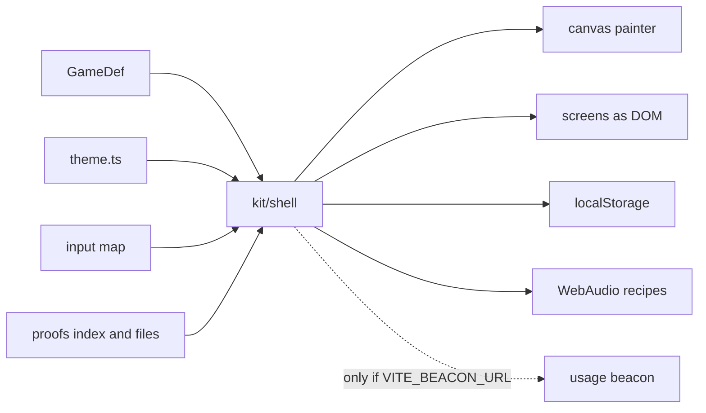

# Design Document

## Overview

`kit/shell` is a small browser package with no framework. It owns the screens, the canvas painter, input, the tick clock, sound, storage and the watch mode. A game gives it four things: its definition, a theme, an input map and its proof files. `kit/create` holds the scaffold. `site/` holds two static pages. Vite builds everything into `dist/`.

## Architecture



Files:

```
kit/shell/src/mount.ts        mountGame
kit/shell/src/screens/        one file for each screen, plain DOM
kit/shell/src/router.ts       which screen is open, with history
kit/shell/src/play.ts         session, tick clock, input, undo
kit/shell/src/painter.ts      canvas painter and move animation
kit/shell/src/layout.ts       control boxes and the rules of requirement 6.3
kit/shell/src/audio.ts        sound recipes
kit/shell/src/storage.ts      progress and settings, with a memory fallback
kit/shell/src/watch.ts        watch mode
kit/shell/src/beacon.ts       usage beacon
kit/shell/src/theme.ts        Theme type and checkTheme
kit/create/template/          the scaffold template
kit/create/src/new-game.ts    the new:game command
site/index.html  site/privacy.html
e2e/                          Playwright tests
```

## Components and Interfaces

```ts
export interface Theme {
  name: string;
  palette: { background: string; surface: string; primary: string; secondary: string; accent: string; text: string; muted: string; danger: string };
  buttonRadius: number;                          // px
  typeScale: { small: number; body: number; title: number };
  signature: 'leaf' | 'star' | 'notch' | 'wave'; // corner shape drawn on panels and buttons
  sprites: Record<string, string>;               // sprite name to image URL inside the app
  sounds: Record<SoundName, SoundRecipe>;
}
export type SoundName = 'tap' | 'move' | 'win' | 'lose' | 'pickup';
export interface SoundRecipe { wave: 'sine' | 'square' | 'triangle' | 'sawtooth'; notes: { hz: number; ms: number }[]; gain: number }

export interface InputMap<S> {
  toAction(event: { type: 'pointer'; itemId: string | null } | { type: 'key'; key: string }, state: S): string | null;
  lessons: { id: string; anchorItemId: string; text: string }[];  // at most 4, text at most 6 words
}

export interface ProofSet { index: { game: string; levels: { id: string; actions: number }[] }; load(levelId: string): Promise<unknown> }

export function mountGame<S extends Json, A>(element: HTMLElement, options: {
  def: GameDef<S, A>; theme: Theme; input: InputMap<S>; proofs: ProofSet; credits: string[];
}): { destroy(): void };

export function checkTheme(theme: Theme): string[];   // saturation and contrast problems
export function checkControls(boxes: ControlBox[], viewport: Viewport): string[]; // layout problems, one line each
export interface ControlBox { screen: string; id: string; x: number; y: number; w: number; h: number }
```

Pointer events resolve to the id of the top scene item under the pointer. This is why scene item ids are stable.

Tick clock: an accumulator adds the frame time. While it holds at least one tick length, apply one action and subtract one tick length, at most 5 times in one frame. If more is left after 5, set the accumulator to 0.

## Data Models

Storage value under `kit.<gameId>.v1`:

```json
{ "version": 1, "levels": { "g01": { "stars": 3, "best": 2 } }, "settings": { "sound": true, "music": true }, "lessons": { "tap-lantern": 2 } }
```

A stored value that does not parse or has another version is ignored and replaced on the next save.

Beacon body, sent with `navigator.sendBeacon` as JSON: `{ "game": "garden", "event": "level_end", "level": "g03", "result": "won" }`. `result` is present only for `level_end`. Nothing else is sent.

## Error Handling

- Storage errors switch to a memory store for the page visit and set the one time notice.
- A proof file that fails to load hides the star par and the watch button for that level. Play still works.
- An error thrown inside a game's `step` or `view` during play opens a plain panel with the level id, the seed and a button that copies the replay. The page does not go blank.
- Audio failure is silent. The game never waits for sound.

## Testing Strategy

- Unit tests with Vitest and a DOM test environment for `storage`, `layout`, `theme`, `play` (tick clock with a fake timer), and `watch`. Each is written first and seen to fail.
- `checkTheme` tests: a grey theme fails with a message that names `primary`, and both shipped themes pass.
- Tick clock test: 1000 ms of fake time at 60 ticks a second applies exactly 60 actions, and one 500 ms frame applies 5 and drops the rest.
- Playwright tests in `e2e/`, headless only: `layout.spec.ts` (requirement 6.4, real boxes from `getBoundingClientRect` for every element with `data-control`), `good-path.spec.ts` and `bad-path.spec.ts` for each game (requirement 10).
- The good path test turns each proof replay into real events: for the garden puzzle a click on the scene item of the lantern or the wait control, for the runner a key press on the right tick.
- `new:game` test: run the command in a copy of the repository in a temporary folder, then run `verify` and `prove` there.

## Correctness Properties

1. **Shell equals session.** For any proof replay sent as input events, the hash after the last event equals the proof's `finalHash`. (Requirements 3.1, 3.2, 10.1)
2. **Tick count.** For any sequence of frame times that sum to T ms with no frame over 80 ms, the number of applied actions is `floor(T * ticksPerSecond / 1000)` or one less. (3.2)
3. **Stars are monotone.** A better result never lowers the stored stars of a level. (4.1, 4.2)
4. **Lessons stop.** No lesson is shown a fourth time, for any order of visits and reloads. (5.2)
5. **Controls fit.** For every screen and every listed viewport, `checkControls` returns no problem. (6.3, 6.4)

## Decisions and Alternatives

- Plain DOM for screens and canvas for play. Chosen because buttons and text get keyboard focus and screen reader names for free, and the play area stays fast.
- No UI framework. Chosen to keep the kit small and its licence list short.
- Proof replays as the play through script. Chosen because the test then covers every level with no hand written steps.
- The beacon is off by default. Chosen so that a copy of the repository built by someone else sends nothing.

## Out of Scope

- Accounts, cloud saves, leaderboards and multiplayer.
- A level editor in the browser.
- Translations. All text is English and sits in one file for each game.
- Native app packaging.
