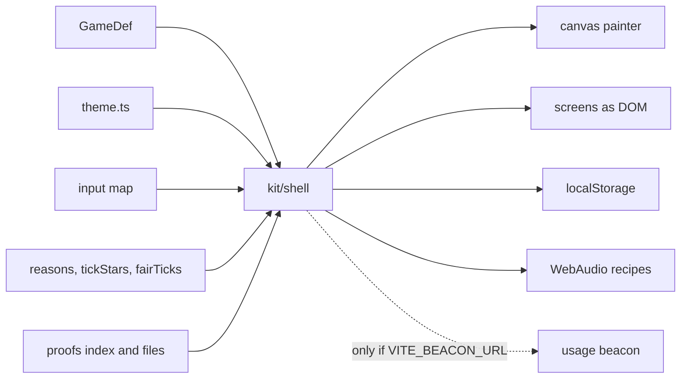

# Design Document

## Overview

`kit/shell` is a small browser package with no framework. It owns the screens, the canvas painter, input, the tick clock, sound, storage and the watch mode. A game gives it its definition, a theme, an input map, its proof files and a few texts. `kit/create` holds the scaffold. `site/` holds two static pages. Vite builds everything into `dist/`.

This spec owns the game side files in `apps/garden` and `apps/runner`: `theme.ts`, `index.html`, `src/main.ts`, `src/input.ts` and `src/results.ts`. They sit outside `src/rules`, so the rules never import from `kit/shell`. `game.config.ts` is not changed: the theme is not imported there, because `def.ts` imports `game.config.ts` and the prover and the tool door load `dist/def.js` in Node. The comment in both `game.config.ts` files that says the theme import is added by this spec is out of date and stays as it is.

## Architecture



Files:

```
kit/shell/src/index.ts        the one export file of the package
kit/shell/src/mount.ts        mountGame
kit/shell/src/screens/        one file for each screen, plain DOM
kit/shell/src/router.ts       which screen is open, with history
kit/shell/src/play.ts         session, tick clock, input, undo
kit/shell/src/painter.ts      canvas painter, move animation, effects, itemIdsAt
kit/shell/src/layout.ts       control boxes and the rules of requirement 6.3
kit/shell/src/audio.ts        sound recipes
kit/shell/src/storage.ts      progress and settings, with a memory fallback
kit/shell/src/watch.ts        watch mode
kit/shell/src/beacon.ts       usage beacon
kit/shell/src/beacon-events.ts the list of events and fields, plain data
kit/shell/src/theme.ts        Theme type and checkTheme
kit/create/src/index.ts       the one export file of the package
kit/create/src/new-game.ts    the new:game command
kit/create/template/          the scaffold template, every file ends in .tpl
apps/<id>/theme.ts            the theme of one game
apps/<id>/index.html          the page of one game
apps/<id>/src/main.ts         calls mountGame
apps/<id>/src/input.ts        the input map and its lessons
apps/<id>/src/results.ts      end reason texts, and for a tick game tickStars and fairTicks
site/index.html  site/landing.ts  site/privacy.html
tools/build.mjs               builds the three pages, copies proofs, makes the privacy page, runs the version guard
tools/build-apps.mjs          builds every app listed in kit.config.json
tools/check-versions.mjs      the version guard
tools/themes.test.ts          compares the two themes
e2e/                          Playwright tests, named *.e2e.ts
```

Template files end in `.tpl` and the command removes that ending. Without it, the root typecheck, lint and Vitest would take the template files for real source.

`e2e/`, `examples/`, `playwright.config.ts` and `vite.config.ts` are not in the kit-boundary folder table. They are treated like `tools/`: outside the table. The owner may add them to the table.

Playwright files end in `.e2e.ts`, and `playwright.config.ts` sets `testMatch` to that ending. Vitest takes every `*.spec.ts` and `*.test.ts` it finds, and it would run a `.spec.ts` of Playwright and fail. The root `tsconfig.json` gets `e2e/**/*.ts` and `site/**/*.ts` in `include`.

The kit never contains a game word, and a test searches for them. The tests of `kit/shell` use neutral ids such as `item-1`. The e2e files and the game side files may use the game words.

## Components and Interfaces

```ts
import type { GameDef, Json, Replay, Scene, Viewport } from '@kit/core';

export interface Theme {
  name: string;
  palette: { background: string; surface: string; primary: string; secondary: string; accent: string; text: string; muted: string; danger: string }; // each '#rrggbb'
  buttonRadius: number;                          // px
  typeScale: { small: number; body: number; title: number };
  signature: 'leaf' | 'star' | 'notch' | 'wave'; // corner shape drawn on panels and buttons
  sprites: Record<string, string>;               // sprite name to image URL inside the app
  sounds: Record<SoundName, SoundRecipe>;
  music: SoundRecipe;                            // played again and again while the music switch is on
}
export type SoundName = 'tap' | 'move' | 'win' | 'lose' | 'pickup';
export interface SoundRecipe { wave: 'sine' | 'square' | 'triangle' | 'sawtooth'; notes: { hz: number; ms: number }[]; gain: number }

export type InputEvent = { type: 'pointer'; itemIds: string[] } | { type: 'key'; key: string };
export interface Lesson { id: string; anchor: string; text: string }   // anchor is a scene item id or a button id; text at most 2 words
export interface InputButton { id: string; label: string; action: string }
export interface InputMap<S> {
  idle: string | null;                                       // the action of a tick that has no input, null for a turn game
  toAction(event: InputEvent, state: S): string | null;
  buttons: InputButton[];                                    // play strip buttons that apply one action
  anchorFor(actionText: string): string | null;              // the item or button an action is about, for the watch pointer mark
  lessons: Lesson[];                                         // at most 4
}

export interface GameTexts<S> {
  reasons: Record<string, string>;                           // status.reason to the text of the results screen
  tickStars?(start: S, end: S): 1 | 2 | 3;                   // required for a tick game
  fairTicks?(levelId: string): number | null;                // required for a tick game
}

// The file that `npm run prove` writes. The shape is the one in kit/solver/src/prove.ts.
export interface ProofFile {
  format: 1; game: string; kind: 'turn' | 'tick'; level: string; rulesVersion: string; seed: number;
  checks: { name: string; passed: boolean; detail: string }[];
  replay: Replay;                                            // actions are run length text such as "wait*2"
  stats: { actions: number; nodes: number };
}
export interface ProofIndex { game: string; levels: { id: string; actions: number }[] }
// A game builds this with `fetch` from `../proofs/<game>/` in the built site, so an app never imports from `proofs/`.
export interface ProofSet { loadIndex(): Promise<ProofIndex>; load(levelId: string): Promise<ProofFile> }

export function mountGame<S extends Json, A>(element: HTMLElement, options: {
  def: GameDef<S, A>; theme: Theme; input: InputMap<S>; proofs: ProofSet; texts: GameTexts<S>; credits: string[];
}): { destroy(): void };

export function checkTheme(theme: Theme): string[];   // saturation and contrast problems
export interface Rect { x: number; y: number; w: number; h: number }
export interface ControlBox { screen: string; id: string; x: number; y: number; w: number; h: number }
export function checkControls(boxes: ControlBox[], viewport: Viewport, playArea?: Rect): string[]; // layout problems, one line each
export function itemIdsAt(scene: Scene, x: number, y: number): string[]; // top item first
```

`Replay`, `Viewport` and `Scene` come from `@kit/core`. `expandActions` and `runReplay` from `@kit/core` read a proof replay, because the replay file holds run length items.

Every level starts with seed 1. The prover uses seed 1, so a proof replay is valid in the shell.

**Hit test.** `itemIdsAt` returns the ids of the items whose box holds the point, top layer first (layer order `back`, `world`, `actors`, `fx`, `hud`, and later items above earlier ones in one layer). It skips `fx` and `hud` items and text items. A box holds `x <= px < x + w` and `y <= py < y + h`. A circle is tested by its own radius. The shell sends a pointer event to `toAction` only when the point is inside the play area. This is why the garden glow cannot hide a lantern, and a moth on a lantern post leaves `lantern-<k>` in the list.

**Play screen layout.** The page is `W` by `H` with bottom safe inset `sb`. The strip is `72 + sb` px high at the bottom. A strip control has its top at `H - sb - 60` and its bottom at `H - sb - 16`. The canvas is the rest: `W` by `H - 72 - sb`. `def.view` gets `{ width: W, height: H - 72 - sb, safe: { top, right, bottom: 0, left } }`. The strip holds the pause button, and for a turn game the undo button and the buttons of the input map, left to right with 12 px between them. The two games already keep their own score or turn text in a 56 px bar at the top of the scene, so no control sits there. A 44 px control does not fit in that bar with a 16 px margin (16 + 44 is 60).

At 360 by 640 with no safe inset: strip top 568, controls from 580 to 624, canvas 360 by 568. The garden puzzle gets a board area of 568 - 56 = 512 px, and its cell is the smaller of 288 / 9 = 32 (with side safe insets of 36) and 512 / 7 = 73, so 32, which is the minimum of the garden spec.

**Data attributes for tests.** Every button has `data-control="<id>"`. Every screen root has `data-screen="<name>"`. The play root has `data-tick` (the session tick), `data-phase` and `data-hash`. The canvas has `data-scene`, a JSON list of `{ id, x, y, w, h }` in CSS px of every item with a box, set after each paint. The e2e tests click and read with these, because a canvas has no element for each item.

**Tick clock.** Time is added in units of ms times ticks per second: `acc += dtMs * tps`. A tick is due while `acc >= 1000`. Apply one action and subtract 1000, at most 5 times in one frame. If `acc >= 1000` is still true after 5, set `acc` to 0. This is integer arithmetic for whole millisecond frames, so there is no drift. In watch mode the time is multiplied by the speed and the limit is `5 * speed`. The pending input is the last non-null action since the previous tick. It is used by the next tick and then cleared. A tick with no pending action applies `input.idle`.

A new action in a turn game while a 120 ms move still runs ends that move at once and starts the next.

**Effects.** On a lost level the shell shakes the canvas 8 px for 240 ms. On a win, and on a score rise in a tick game, it flashes the canvas for 120 ms. Both are off when `prefers-reduced-motion: reduce` matches. The shell has no parallax today, and the rule is kept so that none is added without the switch.

**Sounds.** `tap` plays on a button press. `move` plays for each applied action of a turn game. `pickup` plays when the score rises in a tick game. `win` and `lose` play when the results screen opens.

**Lessons.** At the start of the first level the shell shows each lesson with a count under 3 as a hint box next to the box of its anchor, adds 1 to its count, and removes all hints at the first applied action. A hint box does not take pointer events. A hint box is a text chip: the shell measures it, keeps its text at the theme's small size, and places it above its anchor, left edges equal. If that would put it less than 16 px from the screen or the safe area, or over its anchor or another chip, the shell clamps it inward and then tries below, right of and left of the anchor, and then shifted by whole chip heights. A retry of the first level is a new level start. A test measures every chip of every garden level at the seven layout viewports and fails when a chip is closer than 16 px to an edge or overlaps another chip, and the layout e2e test measures the chips of the first level in a browser.

## Data Models

Storage value under `kit.<gameId>.v1`:

```json
{ "version": 1, "levels": { "g01": { "stars": 3, "best": 2 } }, "settings": { "sound": true, "music": true }, "lessons": { "tap-lantern": 2 } }
```

`best` is the fewest actions for a turn level and the highest score for a tick level. `stars` and `best` only improve. A level counts as finished when its `stars` is 1 or more. A stored value that does not parse or has another version is ignored and replaced on the next save.

Beacon body, sent with `navigator.sendBeacon` as a `Blob` of type `text/plain`, so that no preflight request is needed: `{ "game": "garden", "event": "level_end", "level": "g03", "result": "won" }`. `level` is present for `level_start`, `level_end` and `watch_start`. `result` is present only for `level_end`. `open` has only `game` and `event`. Nothing else is sent. The list of events and fields is plain data in `beacon-events.ts`. `beacon.ts` and the privacy page both read it.

## Error Handling

- Storage errors switch to a memory store for the page visit and set the one time notice.
- A proof file or the proof index that fails to load hides the star par and the watch button for that level. Play still works.
- An error thrown inside a game's `step` or `view` during play opens a plain panel with the level id, the seed and a button that copies the replay, or shows the replay text when the copy is refused. The page does not go blank.
- Audio failure is silent. The game never waits for sound.
- A `?watch=` value that is not a level of the game is ignored.

## Testing Strategy

- Unit tests with Vitest for `storage`, `layout`, `theme`, `painter`, `play` (tick clock with plain numbers), `router`, `screens`, `stars`, `lessons`, `audio`, `watch` and `beacon`. A file that needs the DOM starts with the comment `// @vitest-environment jsdom`, because the root has no Vitest config. Each test file is written first and seen to fail.
- `checkTheme` tests: a grey theme fails with a message that names `primary`, and both shipped themes pass. `tools/themes.test.ts` checks that the two shipped themes differ in `palette.primary`, `buttonRadius` and `signature`.
- `checkControls` tests at 360 by 640 with safe 0: a box at x 15 fails the 16 px rule and x 16 passes; a width of 43 fails and 44 passes; two boxes 11 px apart fail and 12 px apart pass; a box with right edge 345 fails and 344 passes; with a left safe inset of 36, x 51 fails and x 52 passes; a box with bottom 569 and a play area ending at 568 fails the overlap rule, and one starting at 580 passes.
- Tick clock tests, with whole millisecond frames at 60 ticks a second: 50 frames of 20 ms apply exactly 60 actions in total (50 * 20 * 60 / 1000). One frame of 500 ms owes 30, applies 5 and sets the remainder to 0. One frame of 84 ms owes 5.04, applies 5 and keeps 40 in `acc`. One frame of 100 ms owes 6, applies 5 and sets `acc` to 0. At 4 times speed, a frame of 16 ms adds 16 * 4 * 60 = 3840 and applies 3.
- Hit test: two items with the same box on `world` and `actors`, plus an `fx` circle over the point, give the two ids with the `actors` id first. The point on the right edge of a box (x equal to `x + w`) gives no id.
- Stars: par 4 gives 3 stars for 3 and 4 actions, 2 stars for 5 and 6, and 1 star for 7. Runner stars: 4 candles at the start, 4 taken gives 3, 2 taken gives 2, 1 taken gives 1, 0 taken gives 1; 3 candles, 2 taken gives 2, 1 taken gives 1; 0 candles gives 3.
- Lessons: a first level started 4 times shows each lesson 3 times, and the fourth start shows none.
- Input maps, on the real first level of each game with the rules of the garden puzzle (rows `2f1..`, `m..#.`, `.f...`): with no lantern lit, ids `['moth-1', 'lantern-1']` give `light:1`, `['lantern-2']` gives `light:2`, `['flower-1-0']` and `[]` give null, and key `3` and a space give null. With lantern 1 lit, `['lantern-1']` gives `wait`, `['lantern-2']` gives `light:2`, key `1` gives `wait`, key `2` gives `light:2` and a space gives `wait`. The runner gives `jump` for any pointer event and for a space, and null for the key `a`.
- Playwright tests in `e2e/`, headless only: `layout.e2e.ts` (requirement 6.4, real boxes from `getBoundingClientRect` for every element with `data-control`, plus the padding of its text, for both games), `good-path`, `bad-path` and `keyboard` files for each game (requirement 10), and `site.e2e.ts` (the landing page at 1280 by 720 and 360 by 640 shows the frame inside the first screen, the watch run starts with no tap, and the three other pages answer).
- The good path test turns each proof replay into real events. It expands the run length items with `expandActions`. For the garden puzzle it clicks the centre of the box of the lantern from `data-scene`, or the `wait` button. For the runner it uses `page.clock.install()` and runs the fake clock 16 ms at a time, because every 16 ms frame applies at most one tick (960 is added to `acc` and a tick needs 1000). It reads `data-tick`. For a `jump` at index `i` it runs frames until `data-tick` is `i`, presses the space key, then runs frames until `data-tick` is `i + 1`. That the fake clock calls `requestAnimationFrame` every 16 ms is an assumption of this test. It is checked in the task, and if it does not hold the task is written up as not done. At the end it checks `data-phase` is `won` and `data-hash` equals `replay.finalHash`.
- The browser for Playwright is a download, not an npm package. When it cannot be installed, the e2e tasks are logged as not run.
- `new:game` test: copy the repository without `node_modules` into a temporary folder, link `node_modules` with a junction, run the command, then run `prove` and `verify` there. The test also checks that every created file has no byte order mark and no CR.
- The build test scans `dist/` for loads from another site (requirement 1.3), checks the four pages exist, and checks that a build with no `VITE_BEACON_URL` holds no `sendBeacon` call that can run (the beacon module returns at once when the url is empty, and the test calls it with a fake `navigator`).

## Correctness Properties

1. **Shell equals session.** For any proof replay sent as input events with seed 1, the hash after the last event equals `replay.finalHash` of the proof file. (Requirements 3.1, 3.2, 3.7, 10.1)
2. **Tick count.** For any sequence of whole millisecond frame times that sum to T ms with no frame over 80 ms, the number of applied actions is exactly `floor(T * ticksPerSecond / 1000)`. (3.3, 3.4)
3. **Stars are monotone.** A better result never lowers the stored stars or best of a level. (4.1, 4.2, 4.3)
4. **Lessons stop.** No lesson is shown a fourth time, for any order of visits and reloads. (5.2)
5. **Controls fit.** For every screen and every listed viewport, `checkControls` returns no problem. (6.3, 6.4)
6. **Illegal input changes nothing.** For any input event, when `toAction` returns null or a text that is not in `session.legal()`, the session hash after the event equals the hash before it. (3.2)

## Decisions and Alternatives

- Plain DOM for screens and canvas for play. Chosen because buttons and text get keyboard focus and a name from the browser, and a canvas holds the play area. No speed or screen reader result is claimed here. A claim needs a recorded check with a named tool.
- No UI framework. Chosen to keep the kit small and its licence list short.
- Proof replays as the play through script. Chosen because the test then covers every level with no hand written steps.
- The beacon is off by default. Chosen so that a copy of the repository built by someone else sends nothing.
- This spec owns the input map and the lessons of both games. Chosen because both game specs already name it as the owner, `InputMap` is a type of this spec, and the files sit in app folders that no other task of this spec's list changes. Each game gets its own task, so one task changes one folder.
- The play controls sit in a strip under the scene, not in the 56 px bar of the scenes. A control needs 16 + 44 px and the bar has 56.
- The landing page shows the watch run in a frame of `/garden/?watch=g03`. Chosen because `site/` may use built outputs only, and the page then needs no import of the shell or of a game.
- The text of the runner proof is `Proved: every jump has N ticks or more`. The earlier text said `Proved fair`. A proof file shows that a level can be finished and that a jump has a window in ticks. It does not show that the level is fair to a person. The owner may choose other words.
- N of the runner comes from `levelPlans`, because the proof file holds the check `window_ok` with a free text detail and no number field. It shows only the windows the plan requires, and the check passed.

## Out of Scope

- Accounts, cloud saves, leaderboards and multiplayer.
- A level editor in the browser.
- Translations. All text is English and sits in one file for each game.
- Native app packaging.
