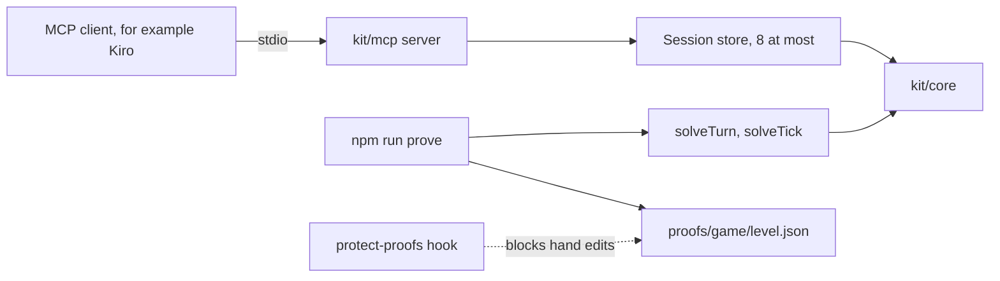

# Design Document

## Overview

`kit/mcp` is one small server that opens any game definition to MCP clients. `kit/solver` holds two searches and the prove command. Both packages import only `kit/core`. The games add nothing except an optional `proof.ts` with their own level checks.

## Architecture



Files:

```
kit/mcp/src/server.ts      argument parsing, loading the definition, MCP wiring
kit/mcp/src/tools.ts       the five tool handlers as plain functions
kit/mcp/src/store.ts       session store with least recently used eviction
kit/solver/src/turn.ts     solveTurn
kit/solver/src/tick.ts     solveTick
kit/solver/src/prove.ts    the prove command
kit/solver/src/index.ts    the only export file
kit.config.json            { "games": ["apps/garden", "apps/runner"] }
```

The MCP wiring uses the official Model Context Protocol TypeScript SDK. Read the SDK's own README for the server and stdio transport calls at the version you pin. Do not guess its API. Write the package name, the version and the licence in the log row.

## Components and Interfaces

Tool inputs and outputs. Every output is one text content item that holds JSON, except `render`.

| Tool | Input | Output |
| --- | --- | --- |
| `new_game` | `{ level?: string, seed?: number }` | No level: `{ game, kind, levels }`. With level: `{ session, level, seed, tick, status, observation, legal }` |
| `act` | `{ session: string, actions: string[] }` | `{ applied, stoppedBy, tick, status, hash, observation, legal }` |
| `observe` | `{ session: string }` | `{ tick, status, hash, observation, legal }` |
| `render` | `{ session: string, format: "svg" or "text" }` | The SVG text, or the plain text view |
| `replay` | `{ session: string, save?: boolean }` or `{ replay: Replay }` | `{ replay, file? }` or the `runReplay` result |

- `stoppedBy` is `null`, `"bad_action_text"`, `"illegal_action"` or `"game_over"`.
- Session ids are `s1`, `s2` and so on. An evicted id is never used again.
- An error result sets `isError` true and holds `{ "error": code, "message": text }`. Codes: `unknown_session`, `unknown_level`, `bad_seed`, `too_many_actions`, `bad_input`.

The tool handlers in `tools.ts` take a store and a definition and return plain objects. They do not import the SDK. This lets unit tests call them directly.

Solver:

```ts
export interface TurnOptions {
  maxNodes?: number;                       // default 200000
  maxDepth?: number;                       // default 60
  key?: (state: Json) => Json;             // default: the state
  allow?: (actionText: string) => boolean; // default: every legal action
}
export interface TickOptions { maxTicks?: number; maxStatesPerTick?: number } // defaults 7200 and 5000
export type SolveResult =
  | { solved: true; actions: string[]; nodes: number }
  | { solved: false; reason: 'exhausted' | 'node_limit' | 'depth_limit'; nodes: number };
export function solveTurn<S extends Json, A>(def: GameDef<S, A>, levelId: string, seed: number, options?: TurnOptions): SolveResult;
export function solveTick<S extends Json, A>(def: GameDef<S, A>, levelId: string, seed: number, options?: TickOptions): SolveResult;
```

Optional file in a game, built to `<appDir>/dist/proof.js`:

```ts
export interface CheckResult { name: string; passed: boolean; detail: string }
export interface ProofTools { solveTurn: typeof solveTurn; solveTick: typeof solveTick }
export const turnOptions: TurnOptions | undefined;
export function levelChecks(def: GameDef<Json, unknown>, levelId: string, result: SolveResult, tools: ProofTools): CheckResult[];
```

## Data Models

Proof file `proofs/<game>/<level>.json`:

```json
{
  "checks": [{ "detail": "shortest solution has 7 actions, band is 7 to 10", "name": "length_in_band", "passed": true }],
  "format": 1,
  "game": "garden",
  "kind": "turn",
  "level": "g07",
  "replay": { "actions": ["light:2", "wait*2"], "finalHash": "0123456789abcdef", "finalPhase": "won", "format": 1, "game": "garden", "level": "g07", "rulesVersion": "0.1.0", "seed": 1 },
  "rulesVersion": "0.1.0",
  "seed": 1,
  "stats": { "actions": 7, "nodes": 412 }
}
```

The values above show the shape only. Index file `proofs/<game>/index.json`: `{ "game": "garden", "levels": [{ "id": "g01", "actions": 2 }] }`.

- The seed is 1 for every proof.
- `stats.actions` counts actions after expansion. For a turn game it is par.
- The prove command builds all proofs in memory first. It replaces the files only when every level passed.

## Error Handling

- The tool door never crashes on bad input. A handler that throws is a bug. The server catches it, returns an error result with code `bad_input`, and writes the stack to standard error.
- `prove` exit codes: 0 all proven, 1 a level or a check failed, 2 a difference in `--check` mode, 3 a missing or bad `kit.config.json` or game build.
- The hook script exits 2 to block. Exit code 2 as the blocking code is read from the Kiro hooks reference for the Pre Tool Use trigger at the installed version. Confirm it there and write the observation in the log before relying on it.

## Testing Strategy

- Handler tests call `tools.ts` directly with `sample-lights` and `sample-hop`. Each one is written first and seen to fail.
- One process test starts the built server, sends an MCP initialize and a tool list request over a pipe, and expects the five tool names.
- `solveTurn` tests: for each `sample-lights` level, a slow reference search written inside the test (all action lists of length 1, then 2, then 3) must give the same shortest length. With `allow` set to refuse every action the result is `exhausted`.
- `solveTick` tests: `sample-hop` level `h1` is solved and its replay passes `runReplay`. A level with two blocked cells next to each other is `exhausted`.
- Prove tests run the command in a temporary folder with a config that lists the two samples: first run exit 0, second run with `--check` exit 0, then one byte changed in a proof gives exit 2, then a level made impossible gives exit 1 and leaves the files as they were.
- Hook test: the two cases in requirement 10.2.

## Correctness Properties

1. **Tool door equals session.** For any level, seed and action list, the hash returned by `act` equals the hash of a `kit/core` session given the same actions. (Requirements 3.1, 4.1)
2. **Observe changes nothing.** For any session, any number of `observe` and `render` calls leave the hash unchanged. (4.1, 5.1)
3. **A solution is real.** Whenever a search returns `solved` true, its action list passes `runReplay` with final phase `won`. (7.1, 8.1)
4. **Shortest.** For `sample-lights`, no action list shorter than the `solveTurn` result wins the level. (7.1)
5. **Prove is repeatable.** Two runs of `prove` on the same tree give the same bytes in every proof file. (9.2)
6. **A failed prove changes nothing.** After a run that exits 1, every file in `proofs/` has the bytes it had before. (9.3)

## Decisions and Alternatives

- One generic server over one server for each game. Chosen so that a new game gets the tool door with no new code.
- Text and SVG output over PNG. Chosen because it needs no native image library and an AI tool reads both directly.
- Breadth first search over a smarter search. Chosen because the levels are small and the first result is the shortest, which gives par for free.
- Level checks live in the game, not in the solver. Chosen so that the kit holds no game words.

## Out of Scope

- Remote MCP transport, authentication, and more than one game in one server process.
- Any use of an AI model inside the prover.
- Scoring how fun a level is.
