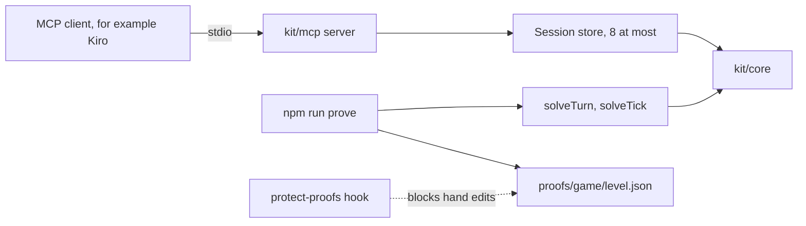

# Design Document

## Overview

`kit/mcp` is one small server that opens any game definition to MCP clients. `kit/solver` holds two searches and the prove command. Both packages import only `kit/core`. A game provides `<appDir>/dist/def.js` with its definition as the default export, and an optional `proof.ts` with its own level checks. Building those files belongs to each game's own spec.

## Architecture



Files:

```
kit/mcp/src/server.ts      argument parsing, loading the definition, MCP wiring
kit/mcp/src/tools.ts       the five tool handlers as plain functions
kit/mcp/src/store.ts       session store with least recently used eviction
kit/mcp/src/index.ts       the only export file
kit/mcp/test-fixtures/     copies of sample-lights and sample-hop, each built to dist/def.js
kit/solver/src/turn.ts     solveTurn
kit/solver/src/tick.ts     solveTick
kit/solver/src/prove.ts    the prove command
kit/solver/src/index.ts    the only export file
kit/solver/test-fixtures/  copies of sample-lights and sample-hop, and no-hop, each built to dist/def.js
kit.config.json            { "games": ["kit/solver/test-fixtures/sample-lights", "kit/solver/test-fixtures/sample-hop"] }
```

`kit.config.json` lists the two sample copies until the game specs exist. Each game spec adds its own `apps/<name>` folder to the list.

The test fixtures are copies because the kit-boundary table lets `kit/mcp` and `kit/solver` import only from `kit/core`. `kit/core` does the same in `kit/core/src/test-fixtures.ts`. Each copy has the same rules, ids, levels and rules version as the sample in `kit/conformance`. `no-hop` is the sample-hop copy with id `no-hop` and an `actions` that lists only `none`, so every level of it is lost.

The MCP wiring uses the official Model Context Protocol TypeScript SDK. Read the SDK's own README for the server and stdio transport calls at the version you pin. Do not guess its API. Write the package name, the version and the licence in the log row.

Build: `kit/core` points its `main` at TypeScript source whose relative imports have no file extension, so plain `node` cannot load it. `kit/mcp` and `kit/solver` are built with esbuild (MIT licence; pin the version and write it in the log row) into self-contained ES modules with `@kit/core` bundled in: `kit/mcp/dist/server.js` and `kit/solver/dist/prove.js`. Each fixture's `def.ts` is bundled the same way to `test-fixtures/<name>/dist/def.js`. Vitest runs the TypeScript source and needs no build. Because the server and the definition may each hold their own copy of `kit/core`, the server reads the `code` of a thrown error and never uses `instanceof KitError`.

## Components and Interfaces

Tool inputs and outputs. Every output is one text content item that holds JSON, except `render`.

| Tool | Input | Output |
| --- | --- | --- |
| `new_game` | `{ level?: string, seed?: number }` | No level: `{ game, kind, levels }`. With level: `{ session, level, seed, tick, status, observation, legal }` |
| `act` | `{ session: string, actions: string[] }` | `{ applied, stoppedBy, tick, status, hash, observation, legal }` |
| `observe` | `{ session: string }` | `{ tick, status, hash, observation, legal }` |
| `render` | `{ session: string, format: "svg" or "text" }` | The SVG text, or the plain text view |
| `replay` | `{ session: string, save?: boolean }` or `{ replay: Replay }` | `{ replay, file? }` or the `runReplay` result |

- `stoppedBy` is `null`, `"bad_action_text"`, `"illegal_action"` or `"game_over"`.
- Session ids are `s1`, `s2` and so on. An evicted id is never used again. Creating a session and every call that names it mark it as used.
- `act` expands each item on its own with `expandActions([item])`. It adds up the counts first. More than 3600 actions in total, or more than 600 items, gives `too_many_actions` and nothing is applied. A malformed item counts as one action. When the run reaches it, the run stops with `bad_action_text` and `apply` is not called.
- `render` builds the scene with `def.view(state, { width: 960, height: 540, safe: { top: 0, right: 0, bottom: 0, left: 0 } })` and paints it with `paintSvg(scene)` with no sprite map.
- The `replay` save path is `<appDir>/tests/replays/<game>-<level>-<finalHash>.json`. It follows the determinism rule that replays found by play live in the game's `tests/replays/`.
- An error result sets `isError` true and holds `{ "error": code, "message": text }`. Codes: `unknown_session`, `unknown_level`, `bad_seed`, `too_many_actions`, `bad_input`, `internal_error`.

The tool handlers in `tools.ts` take a store and a definition and return plain objects. They do not import the SDK. This lets unit tests call them directly.

Solver:

```ts
export interface TurnOptions {
  maxNodes?: number;                       // default 200000
  maxDepth?: number;                       // default 60
  key?: (state: Json) => Json;             // default: the state
  allow?: (actionText: string) => boolean; // default: every legal action
}
export interface TickOptions { maxTicks?: number; maxStatesPerTick?: number } // defaults 7200 and 5000
export type SolveResult =
  | { solved: true; actions: string[]; nodes: number }
  | { solved: false; reason: 'exhausted' | 'node_limit' | 'depth_limit'; nodes: number };
export function solveTurn<S extends Json, A>(def: GameDef<S, A>, levelId: string, seed: number, options?: TurnOptions): SolveResult;
export function solveTick<S extends Json, A>(def: GameDef<S, A>, levelId: string, seed: number, options?: TickOptions): SolveResult;
```

- `actions` in a `SolveResult` is the plain list of action texts, not compressed.
- `solveTurn` is a breadth first search. It tries actions in the order of `def.actions` and marks a key as visited when the state is first reached. `nodes` counts the visited keys, start included.
- `solveTick` keeps one list of states for each tick. Tick `t + 1` is built from tick `t` in list order, and for each state in the order of `def.actions`. A lost state is dropped and not counted. A state whose hash is already in the new list is dropped. The search stops right after it adds the first won state. Tick `maxTicks` is the last tick built.
- `turn.ts` and `tick.ts` are pure and read no file. The determinism rule bans file access in solver code, so all file reads and writes sit in `prove.ts`, the command. They do not sit in the search.

Optional file in a game, built to `<appDir>/dist/proof.js`:

```ts
export interface CheckResult { name: string; passed: boolean; detail: string }
export interface ProofTools { solveTurn: typeof solveTurn; solveTick: typeof solveTick }
export const turnOptions: TurnOptions | undefined;
export function levelChecks(def: GameDef<Json, unknown>, levelId: string, result: SolveResult, tools: ProofTools): CheckResult[];
```

## Data Models

Proof file `proofs/<game>/<level>.json`, here for the sample-hop copy, level `h1`:

```json
{
  "checks": [],
  "format": 1,
  "game": "sample-hop",
  "kind": "tick",
  "level": "h1",
  "replay": {
    "actions": ["none*9", "hop", "none*29"],
    "finalHash": "<16 hex characters from hashState>",
    "finalPhase": "won",
    "format": 1,
    "game": "sample-hop",
    "level": "h1",
    "rulesVersion": "1",
    "seed": 1
  },
  "rulesVersion": "1",
  "seed": 1,
  "stats": { "actions": 39, "nodes": 151 }
}
```

How the numbers above follow from the sample-hop rules and the `solveTick` order. A hop from cell c keeps the runner safe on cells c + 1 to c + 4, and the runner moves one cell each tick, so every win takes 39 actions. Ticks 1 to 9 hold 2, 3, 4, 4, 4, 4, 4, 4 and 4 states. At tick 10 the path with no hop lands on blocked cell 10 and is dropped. The first state of tick 10 is then the hop from cell 9. The first state of every later tick comes from that hop, so the solution is 9 `none`, 1 `hop`, then 29 `none` (9 + 1 + 29 = 39). Ticks 10 to 38 hold 4 states each. The search stops after the first won state at tick 39. Nodes: 1 + (2 + 3 + 7 × 4) + 29 × 4 + 1 = 151. The `finalHash` is computed by `hashState` at run time and is not written here.

A game with level checks fills `checks` with items such as `{ "detail": "shortest solution has 7 actions, band is 7 to 10", "name": "length_in_band", "passed": true }`.

Index file `proofs/<game>/index.json`, for the same game:

```json
{ "game": "sample-hop", "levels": [{ "actions": 39, "id": "h1" }, { "actions": 39, "id": "h2" }] }
```

- `<game>` is the definition's `id`.
- The seed is 1 for every proof.
- The proof's `replay` is `toReplay()` of a session that applied the solution, so its actions are compressed.
- `stats.actions` counts actions after expansion. For a turn game it is par.
- The prove command builds all proofs in memory first. It replaces the files only when every level passed.
- The root `prove` script builds `kit/solver` and then runs `node kit/solver/dist/prove.js`.

## Error Handling

- The tool door never crashes on bad input. Input that does not fit the schema returns `bad_input`. A handler that throws is a bug. The server catches it, returns an error result with code `internal_error`, and writes the stack to standard error.
- `prove` exit codes: 0 all proven, 1 a level or a check failed, 2 a difference in `--check` mode, 3 a missing or bad `kit.config.json` or game build.
- The hook script exits 2 to block. Exit code 2 as the blocking code is read from the Kiro hooks reference for the Pre Tool Use trigger at the installed version. Confirm it there and write the observation in the log before relying on it.
- The hook script must check only the target path of the write, not the file content. Otherwise, once the hook is on, it blocks every write of a file that mentions `proofs/`, such as `prove.ts`, its test, and this spec.

## Testing Strategy

- Handler tests call `tools.ts` directly with the `kit/mcp/test-fixtures` copies of `sample-lights` and `sample-hop`. Each one is written first and seen to fail.
- One process test starts the built server, sends an MCP initialize and a tool list request over a pipe, and expects the five tool names. Every line the server writes to standard output must parse as a JSON-RPC message.
- `act` cases with fixed results. `["none*5"]` on `sample-hop` `h1`: `applied` 5, `stoppedBy` null, `tick` 5, phase `playing`. `["press:1,1", "press:0,0"]` on `sample-lights` `l1`: `applied` 1, `stoppedBy` `game_over`, phase `won`. `["press:0,0", "press:9,9", "press:1,1"]` on `l1`: `applied` 1, `stoppedBy` `bad_action_text`, tick 1. 601 items of `none`: `too_many_actions`. `["none*3600", "none"]` (2 items, 3601 actions): `too_many_actions`, tick still 0.
- `solveTurn` tests on the `sample-lights` copy. A slow reference search written inside the test tries all action lists of length 1, then 2, then 3 (9 + 81 + 729 = 819 lists). It must give the same shortest length as `solveTurn`: 1 for `l1`, 2 for `l2` and 3 for `l3`. These lengths hold because the 3 by 3 press matrix is invertible over GF(2), so each level has one press set that solves it, and that set is the presses that built the level. With the order rule in requirement 7.1 the results are `["press:1,1"]`, `["press:0,0", "press:2,2"]` and `["press:1,0", "press:0,1", "press:2,2"]`. Each result passes `runReplay` with final phase `won`. With `allow` set to refuse every action the result is `exhausted` with `nodes` 1. With `key` set to the lamps only, `l3` is solved in 3 actions and `nodes` is at most 512. `maxDepth` 2 on `l3` gives `depth_limit`, and `maxDepth` 1 on `l1` still solves. `maxNodes` 10 on `l3` gives `node_limit`, because the start and depth 1 already make 10 keys and depth 2 adds more.
- `solveTick` tests on the `sample-hop` copy. `h1` gives `["none" × 9, "hop", "none" × 29]`, 39 actions and `nodes` 151, and its replay passes `runReplay`. `h2` is solved in 39 actions. The `no-hop` copy on `h1` gives `exhausted` with `nodes` 10: the start plus one state on each of ticks 1 to 9, and the only state of tick 10 is lost. `maxStatesPerTick` 3 on `h1` gives `node_limit`, because tick 3 holds 4 states. `maxTicks` 38 on `h1` gives `depth_limit`, and `maxTicks` 39 solves it.
- Prove tests run the command in a temporary folder with a config that lists the two `kit/solver/test-fixtures` samples. The first run exits 0. A second run with `--check` exits 0. Then one byte changed in a proof gives exit 2. Then a config that also lists `no-hop` gives exit 1 and leaves the files as they were. The test changes files only in its temporary folder, never in the repository's `proofs/`.
- Hook test: the three cases in requirement 10.2, added to the existing `tools/hooks/protect-proofs.test.ts`.

## Correctness Properties

1. **Tool door equals session.** For any level, seed and action list, the hash returned by `act` equals the hash of a `kit/core` session given the same actions. (Requirements 3.1, 4.1)
2. **Observe changes nothing.** For any session, any number of `observe` and `render` calls leave the hash unchanged. (4.1, 5.1)
3. **A solution is real.** Whenever a search returns `solved` true, its action list passes `runReplay` with final phase `won`. (7.1, 8.1)
4. **Shortest.** For `sample-lights`, no action list shorter than the `solveTurn` result wins the level. (7.1)
5. **Prove is repeatable.** Two runs of `prove` on the same tree give the same bytes in every proof file. (9.2)
6. **A failed prove changes nothing.** After a run that exits 1, every file in `proofs/` has the bytes it had before. (9.3)

## Decisions and Alternatives

- One generic server over one server for each game. Chosen so that a new game gets the tool door with no new code.
- Text and SVG output over PNG. Chosen because it needs no native image library and an AI tool reads both directly.
- Breadth first search over a smarter search. Chosen because the levels are small and the first result is the shortest, which gives par for free.
- Level checks live in the game, not in the solver. Chosen so that the kit holds no game words.
- Copies of the samples in each package over importing `@kit/conformance` in tests. Chosen because the kit-boundary table allows only `kit/core`. The other option needs the owner to change that table so that test files may import `kit/conformance`.
- An esbuild bundle over plain `tsc` output. Chosen because `tsc` does not add file extensions to the extensionless imports in `kit/core`, and Node cannot run them as they are.

## Out of Scope

- Remote MCP transport, authentication, and more than one game in one server process.
- Any use of an AI model inside the prover.
- Scoring how fun a level is.
- Building `dist/def.js` and `dist/proof.js` for the real games. Each game spec does that.
