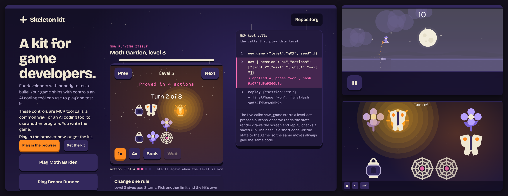

# Skeleton Kit



Play: https://skeleton-kit-games.pages.dev (no login, no account)

Video: https://youtu.be/svm-jh3C0tE (2:51). Guide: 0:00 the problem, 0:20 the landing page, 0:28 Moth Garden, 0:37 levels, 0:44 Broom Runner from its proof, 0:55 Broom Runner played, 1:07 Watch mode, 1:20 the hardest level, 1:28 the proof check, 1:39 the Kiro Crew app, 1:52 keyboard and settings, 2:03 on a phone, 2:08 how Kiro built it, 2:31 a real spec, hook and steering file from the .kiro folder, 2:45 the end card.

## Judging criteria at a glance

**Potential Impact.** Solo developers and small studios have nobody to replay every level after each change, and an AI coding tool writes game code it cannot play. They also compete with a great many games: 27,286 games have been released on Steam so far in 2026, against 21,185 in all of 2025 (GamingOnLinux, article published 2026-11-18, citing SteamDB, https://www.gamingonlinux.com/2026/11/steam-is-officially-drowning-in-game-releases/, read on 20 Nov 2026). That number says how many games a small maker competes with. It is not a measure of this kit. With this kit, `npm run prove -- --check` replays a proof for every level after each change and fails with the exact replay file when a level breaks. Each run is free: the proof is a plain search, not a model. `proofs/garden/index.json` and `proofs/runner/index.json` hold 12 garden levels (2 to 16 actions) and 6 runner courses (687 to 1851 actions). The garden level select shows, for each open level, the fewest actions that win and how many of the legal first moves can still win (spec `difficulty-display`). These are facts of the proof: the proof shows a level can be won, not how it feels to play.

**Technological Implementation.** Kiro wrote the code from 19 specs with 132 tasks, all done (counted in `.kiro/specs/`). Five steering files set the rules, three MCP servers give Kiro each game's tool door, and two custom agents (`playtester`, `runner-playtester`) played levels to a won state through them. A property test found a real bug (a replay whose game field was an object with no prototype threw a TypeError); the fix is in `kit/core/src/replay.ts`. Every task is in `docs/kiro-log.md`.

The Kiro features each have a proof file. The power `power/skeleton-kit/` ran in one headless Kiro CLI 3.5.0 session and won garden level g01 (`docs/acceptance/power-session/`). The hook `protect-proofs` blocked a real write on 16 Nov 2026 (`docs/kiro-log.md`, "Hooks seen to fire"), and `verify-on-stop` ran `npm run verify` at the end of a headless session on 20 Nov 2026 (`docs/acceptance/hook-verify-on-stop.md`). One task was made in Kiro Web, a pull request that merged: https://github.com/Midknight56/skeleton-kit/pull/1 (`docs/acceptance/web-session/`). The Crew app `playcheck` ran on Kiro Crew 0.12.2 and matched 18 of 18 proof replays of this kit, and its second run on version 0.2.1 answered no new commit (the README of the app, https://github.com/Midknight56/playcheck). One feature was built twice, from one paragraph and from a spec, and the same task was run on three models (`docs/acceptance/vibe-vs-spec/` and `docs/acceptance/model-test/`). An axe-core scan of 54 screens of both games found 0 violations (`docs/acceptance/a11y/`).

**Design.** Both games are complete: title, level select with locks and stars, play, pause (also when the page loses focus), results with Next, Retry and Levels, settings with a confirm box before a reset, how to play, credits, a watch mode that plays any level from its proof, a loading screen and a privacy page. Every screen hangs cut paper puppets on strings under one moon: a lantern and moths for the garden, the witch on her broom for the runner. Moths flap, lanterns glow, the broom leaves sparks and dust, and the reduced motion setting turns every effect off. The effects are drawing only, so every proof still replays. The art is SVG drawn in code and every sound is made in code. Headless browser tests measure every control at 360x640, 768x1024 and 1920x1080: 16 px from the screen edge, 12 px between neighbours, nothing overlapping.

**Innovation/Idea.** The same game code runs in three places: the browser, the prover and the tool door. One draw list feeds a canvas painter for players and an SVG text painter for tools and tests, so the picture a program gets is the picture a player sees. A turn puzzle and a real time runner at 60 ticks a second share one contract, which shows the kit is not tied to one kind of game. For the runner the prover also measures how forgiving each jump is: every jump has a window of at least 9 ticks on the first two courses, 6 on the middle two and 4 on the last two (at 60 ticks a second, 150 ms down to 67 ms).

For each turn level the prover also finds the fewest actions that win and how many of the legal first moves can still win. `npm run prove` writes both numbers to `proofs/garden/index.json`, the build step in `tools/level-facts.mjs` copies them into the page, and `kit/shell/src/difficulty.ts` turns them into a row of pips on each open level card on the level select screen. The exact numbers are in the name a screen reader reads. These are facts of the proof: the proof shows a level can be won, not how it feels to play.

**Presentation.** Set the turn limit to 3 and choose **Check it**. The level needs at least four turns. Set the limit to 4 to watch the winning moves on the board. Choose **Restore 8** to return to the original rule. This runs in the browser and uses zero Kiro credits.

The landing page plays a garden level by itself in the first screen and shows the exact tool calls that play it. The picture at the top is made by `tools/capture-hero.mjs` from three captures of the built site: the landing page, a Broom Runner course with the witch mid jump and a garden level in play with a lit lantern.

## What it is

Skeleton Kit is our entry for the Skeleton Crew category: a skeleton code template lean enough to be clear but flexible enough to support various use cases, with two distinct applications built from one foundation. Moth Garden is a turn puzzle and Broom Runner is a one button runner at 60 ticks a second, and both run on the same kit. Kiro built it with spec driven development, from 19 specs. A search script proves that every level of both games can be finished, and any AI tool can play the games through a tool door (an MCP server built from the game's own rules).

Built with Kiro for Kiroween 2026, Skeleton Crew category. Kiro wrote the code from 19 specs, with five steering files, three hooks, three MCP servers, two custom agents and two powers.

## The two apps

| Folder | Game | Kind | Levels |
| --- | --- | --- | --- |
| `apps/garden` | Moth Garden | Turn puzzle: light a lantern, each moth must reach a flower | 12 |
| `apps/runner` | Broom Runner | One button runner: tap to jump, reach the gate | 6 |

A third small game, `examples/lights`, was made with `npm run new:game` to show how a new game starts.

## The kit

| Package | What it does |
| --- | --- |
| `kit/core` | The game contract, sessions, replays, state hashes, repeatable random numbers, SVG text painter. No dependencies. |
| `kit/conformance` | Nine property tests every game must pass, with `fast-check`. |
| `kit/solver` | The prover. Writes and checks `proofs/<game>/<level>.json`. |
| `kit/mcp` | The tool door: an MCP server with five tools (`new_game`, `act`, `observe`, `render`, `replay`). See `docs/tool-door.md`. |
| `kit/shell` | The complete game shell both games use: screens, input, layout, sound, saves, usage events, level facts. |
| `kit/create` | `npm run new:game` makes a new game folder. |

## How Kiro was used

**Kiro IDE.** Two pieces of work are recorded. On 16 Nov 2026 `kit-core` task 12 added twelve properties to the `kit-core` design and tests, and one of them found the TypeError in `kit/core/src/replay.ts` (its row in `docs/kiro-log.md`). On 20 Nov 2026 Kiro IDE 1.4.154 opened a copy of this repository with the spec `garland-text`. One spec task was started from the Start task link, and the IDE asked for approval before each shell command. The three hooks began switched off. The eye icon beside `typecheck-on-save` enabled it, and after a window reload the three hooks were on and the three MCP servers showed `Connected (5 tools)`. Then a new chat session asked the agent to save one file. The chat showed the rows `protect-proofs` and `typecheck-on-save`. The process list shows `cmd.exe /d /s /c "npm run typecheck"` with the parent `Kiro.exe`. A row `verify-on-stop` appeared when the turn ended. The IDE differed from the CLI in four ways: it asks for approval for each shell command, it runs a spec task in a sub agent, it starts hooks switched off, and it connects the MCP servers by itself. A save by hand with Ctrl+S was not tried. The proof is `docs/acceptance/ide-session/`. The log row of that task, `garland-text` task 1, names the surface Kiro CLI 3.5.0, so the counts below put it under the CLI.

**Kiro CLI.** Almost all the code came from the Kiro CLI run with no person at the keyboard (`kiro-cli chat --no-interactive`, model Auto): one prompt per spec review, group of spec tasks or fix, each told to write the test first, run `npm run verify` and add a row to `docs/kiro-log.md`. The log has 142 rows of Kiro work: 88 on Kiro CLI 3.3.0 (16 and 17 Nov 2026), 52 on Kiro CLI 3.5.0 (20, 22 and 24 Nov 2026), 1 on Kiro CLI 3.6.2 (26 Nov 2026) and 1 in the Kiro IDE.

**Kiro Web.** One task was made in Kiro Web on 20 Nov 2026: a new file, `docs/replay-format.md` (103 lines), that explains the replay file the kit writes. Kiro Web opened pull request 1 and it merged: https://github.com/Midknight56/skeleton-kit/pull/1. The proof is `docs/acceptance/web-session/`. Its network was set to repository access only, so Kiro Web could install no package and run no test, which is why the change is a document.

**Kiro Crew.** `playcheck` is a Kiro Crew app in its own repository: https://github.com/Midknight56/playcheck. A Crew agent plays a game built with this kit through its tool door and reports the level, seed, actions, final status and state hash. A nightly job replays the kit's proof of every level and compares the hashes. It ships switched off. Version 0.2.1 keeps the state file of that job in the app's own data folder, because version 0.2.0 lost it between runs. Versions 0.1.0 and 0.2.0 were installed and run on Kiro Crew 0.12.2 on Windows (0.1.0 on 16 Nov 2026, 0.2.0 on 20 Nov 2026). The README of the app records the results. On 20 Nov 2026 three runs of the nightly job gave: run 1 failed because no one approved a tool call, and runs 2 and 3 matched 18 of 18 proof replays and won garden g01 and runner r01, in 45 and 43 seconds. Both runs list the same actions and the same hashes as the proofs for those two levels. Both runs called the kit commit new, so the state of `mark_checked` was lost between runs. Later that day the owner trusted playcheck in the Crew dashboard himself and 0.2.1 was enabled. The nightly job ran twice on version 0.2.1. Run 4 found a new kit commit (46decffc1423863afb37ce4396f64c55e20c33cb), matched 18 of 18 proof replays and won g01 and r01 with the hashes of their proofs, in 36.6 seconds. The agent said it sent the proof's own action lists for those two levels. Run 5, right after, answered "No new commit" for the same hash, in 3.0 seconds. So `mark_checked` keeps its state between runs now, and the state file is in the app's data folder.

**Custom agents.** `.kiro/agents/playtester.json` and `.kiro/agents/runner-playtester.json` have only the game tools and file reads, and may not change any file. Each must play a level to a won status in its own session before it may call the level fine. They ran on the CLI's v2 engine, because the v3 engine loaded no MCP tools in a run with no person at the keyboard. Their tool calls are pasted in `docs/kiro-log.md` under "Tool door transcripts".

**Agent hooks.** `protect-proofs` (PreToolUse) runs `tools/hooks/protect-proofs.mjs` and refuses any write into `proofs/`, so only `npm run prove` can change a proof. It blocked a real write on 16 Nov 2026 (in the log under "Hooks seen to fire"). `verify-on-stop` (Stop) runs `npm run verify` when the agent finishes a turn. It ran at the end of a headless Kiro CLI 3.5.0 session on 20 Nov 2026: `docs/acceptance/hook-verify-on-stop.md` has the times and the event of the session record. `typecheck-on-save` (PostFileSave) runs the type check when a file is saved, and it was seen to fire in the Kiro IDE on 20 Nov 2026 for a file saved by the agent. `docs/acceptance/ide-session/hook-process-log.txt` holds the process list, and the log has a row under "Hooks seen to fire". `protect-proofs` and `verify-on-stop` rows were also seen in that session.

**Spec driven development.** The repository has 19 specs, each with requirements, a design and a task list, 132 tasks in all, counted in `.kiro/specs/`. Five specs built the kit and the games, with 78 tasks: `kit-core`, `tool-door-and-prover`, `garden-puzzle`, `broom-runner` and `shell-and-site`. Fourteen came later, with 54 tasks: `kiro-extensions`, `accessibility-scan`, `first-moves`, `difficulty-display`, `readme-hero`, `garland-text`, `final-mend`, `crew-runs-update`, `tester-fixes`, `menu-contrast-preview`, `landing-try-a-rule`, `runner-jump-timing`, `product-name` and `judge-rule-replay`. The kit was split so that each spec could be built and checked on its own: `kit-core` first (the contract, replays and hashes), then the tool door and prover, then each game, then the shell and site. A task was done only when its tests passed and the proof check passed. A fault found later went back to Kiro as a new task with a failing test first, for example the row "fix: garden lesson chip cut off at the left edge" in `docs/kiro-log.md`. The section after this one compares a spec build with a build from loose requests.

**Steering docs.** Three files are always loaded: `product.md` (who it is for), `kit-boundary.md` (which folder may import which) and `claims-policy.md` (never invent test output, never edit `proofs/` by hand, log every task). Two load only for matching files: `determinism.md` for the rules code (plain JSON state, integers only in a tick game, no clock and no global random) and `game-standards.md` for the shell and apps (every screen, clear in five seconds, spacing rules). The log rows say which tests failed first, what did not run and what was not checked.

**MCP.** `.kiro/settings/mcp.json` starts the kit's own tool door for the garden, the runner and a third small game. With it Kiro can play the games it wrote, not only compile them. The `playtester` agent won a level of the third game through it and the `runner-playtester` agent won runner course r01 (tick 687, score 110), and each replay was checked against the rules.

**Property based testing (PBT).** `kit/conformance` holds nine properties every game must pass (with `fast-check`): repeatable, replay round trip, legal closure, plain data, input not changed, game over is final, action text round trip, undo, and view and observation safe. Kiro added twelve more properties to `kit-core` from its requirements. The property on replay failures found the TypeError bug above, which no unit test had covered.

**Kiro powers.** Two powers, both in this repository and in the Agent Plugins format. The first is `power/skeleton-kit/`. It gives Kiro the five tools of the tool door (`new_game`, `act`, `observe`, `render`, `replay`) and one skill, `play-and-prove`. The skill says a level is fine only after it was played to a won status, that only legal actions are sent, and that `proofs/` is changed only by `npm run prove`. The power starts the server file of your own clone, named by two environment variables, so the clone has to be built first. The steps are in `power/skeleton-kit/README.md`. It was written from the spec `kiro-extensions`. The second, `power/menu-contrast-preview/`, lets us try a menu colour before editing a game. Its one tool, `preview_menu_contrast`, applies the colour in memory and measures the same colour pairs as `tests/a11y/contrast.test.ts`, through the shared file `tests/a11y/contrast-pairs.ts`. It writes no file and needs no account. In the garden, a brighter sky glow (`#ff8a1f4d`) dropped three labels from 4.51 to 4.06 against a minimum of 4.50. A headless Kiro CLI session that only named the keywords "menu contrast" and "sky glow" loaded the power, called the tool and gave those three rows. The proof is `docs/acceptance/menu-contrast-preview/`, and the power was written from the spec `menu-contrast-preview`.

`docs/acceptance/power-session/` holds the saved output of one headless Kiro CLI 3.5.0 session in which the power was installed and Kiro won garden level g01 with two legal actions, using the power's `new_game` and `act` tools. The prompt named no tool. The answer matched the proof file and a run of the garden server. The power was uninstalled afterwards. The folder lists the limits of that one session.

## Spec against vibe, and the model test

The same small feature was built twice from commit `847e6e1` with Kiro CLI 3.5.0, model `auto`, headless, in throwaway worktrees of this repository. The feature: the prover tells, for each turn level, how many of the first moves can still win. The loose build had one paragraph and no spec. The spec build had a spec (`first-moves`). The numbers are from the session records, not from the usage page (`docs/acceptance/vibe-vs-spec/README.md`).

| | Loose build | Spec build |
| --- | --- | --- |
| Kiro runs | 1 | 3 |
| Credits | 2.31 | 7.88 |
| Minutes | 19.5 | 30.9 |
| Test cases added | 1, plus assertions in `prove.test.ts` | 14 (1220 tests before, 1234 after) |
| `npm run verify` at the end | exit 0 | exit 0 |
| Spec files left behind | none | three |

The two builds wrote equal first move numbers for all 23 levels. The loose build named the wrong surface and date in its log row and changed three folders in one task. The spec build stopped at run 2 before any code, because the spec asked for an error code that does not exist, and run 3 fixed the spec and built it. That stop cost one run (0.90 credits, 6.3 minutes).

The model test ran the three tasks of that spec on three models, each in its own worktree from the same commit (`docs/acceptance/model-test/README.md`).

| Model | Credits | Minutes | Test cases added (total after) | `npm run verify` |
| --- | --- | --- | --- | --- |
| `auto` | 5.77 | 18.1 | 14 (1234) | exit 0 |
| `claude-sonnet-5.5` | 10.47 | 21.0 | 17 (1237) | exit 0 |
| `gpt-5.6-luna` | 6.98 | 33.0 | 9 (1229) | exit 0 |

All three wrote first move numbers equal to the reference. Each test is one feature or one task, run once. Minutes include about 5 minutes for the `verify-on-stop` hook at the end of each run.

## Accessibility

The tool is axe-core 4.11.4 (installed) through @axe-core/playwright 4.11.3, a test only tool that no build holds. `e2e/a11y.e2e.ts` runs it with the tags wcag2a, wcag2aa, wcag21a and wcag21aa on 9 screens of both games at 360x640, 768x1024 and 1920x1080: title, level select, play, pause, results, settings, how to play, credits and the confirm box before a reset. That is 54 scans. They write `docs/acceptance/a11y/report.json`, and the first run is kept as `docs/acceptance/a11y/report-before.json`. Violations before: 0 critical, 0 serious, 0 moderate, 0 minor. After: the same, so no accessibility fix was needed. The test fails on any serious or critical violation.

axe lists color-contrast as incomplete on all 54 scans, because the text sits on gradients and images. So `tests/a11y/contrast.test.ts` computes the WCAG 2.1 contrast ratio of 54 pairs of text, icon and border colours of both games against the lightest colour under them, and writes `docs/acceptance/a11y/contrast.json`. The lowest ratio is 4.51 and every pair meets its limit (4.5 for normal text, 3 for large text, icons and control borders). One value changed to get there: the garden glow in `apps/garden/theme.ts`, from alpha 0x4d to 0x41. The contrast check also found the garland text, the level numbers and the note on the title screen, at 10 px and 11 px. It was raised to 12 px. `docs/acceptance/a11y/contrast.json` now records 12px for those rows, and the test in `kit/shell/src/look.test.ts` (`garland text`) keeps each garland size at 12 px or more. Text drawn on the canvas is not covered, because axe cannot read the canvas. Neither check replaces a test with real users.

## Run it

Node 22.22.2 or newer on the 22 line, Node 24.15.0 or newer on the 24 line, or Node 26 or newer. Vitest 5.1.0 and jsdom 31.0.1 refuse older versions.

```
npm install
npm run verify
npm run e2e
```

`npm run verify` runs the type check, lint, build, 1460 unit tests and the proof check. `npm run e2e` runs 232 headless browser tests.

Play a game through its tool door:

```
node kit/mcp/dist/server.js --game apps/garden
```

To make the picture at the top again, run `npm run build`, then `node tools/capture-hero.mjs`.

## Privacy

No account, no login, no personal data. Progress stays in your browser. The usage beacon sends only the events listed on the privacy page, and only when the site is built with a beacon address. It can be switched off in Settings.

## Licence

MIT. Made by Adrian Ferguson.

The fonts Bricolage Grotesque and Sometype Mono are in `assets/fonts` under the SIL Open Font License 1.1 (licence files beside them).
